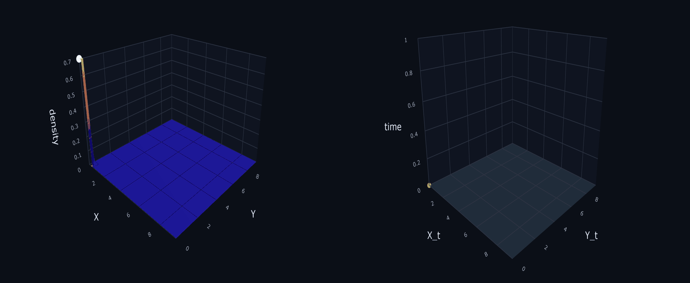
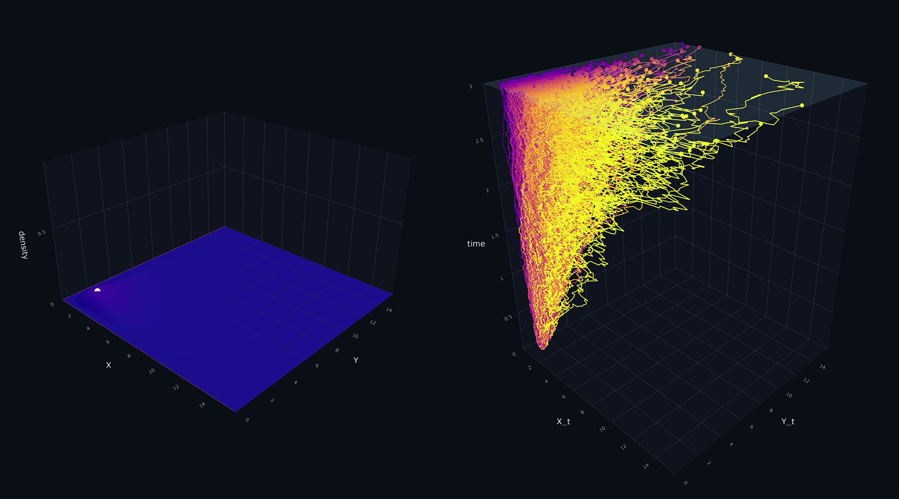
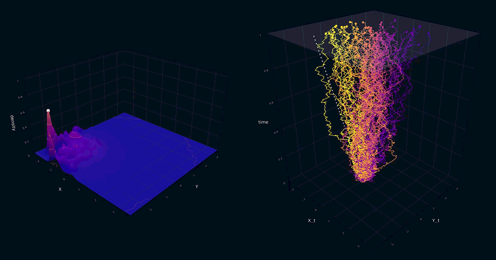
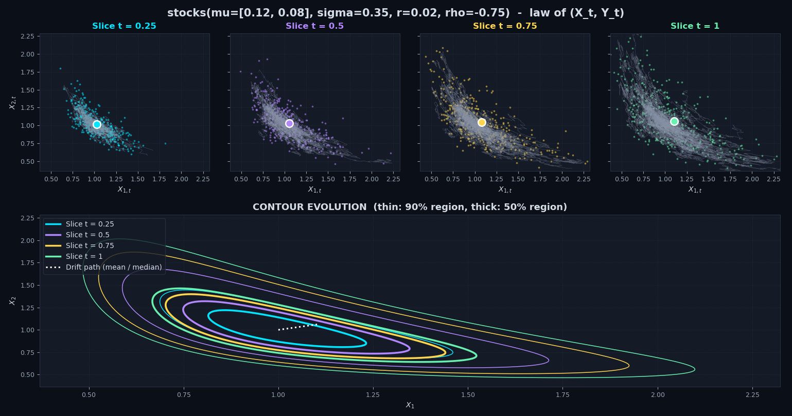
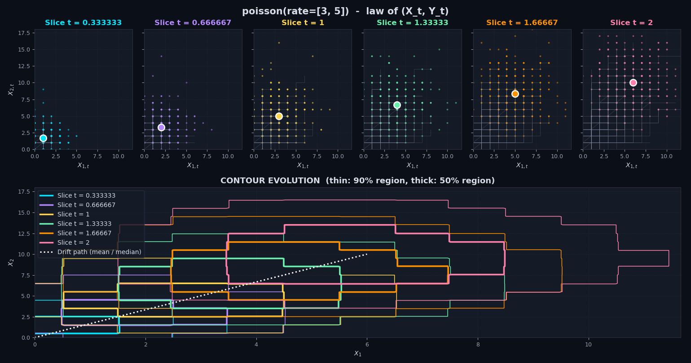
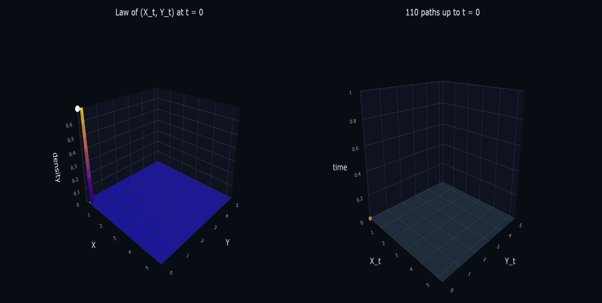
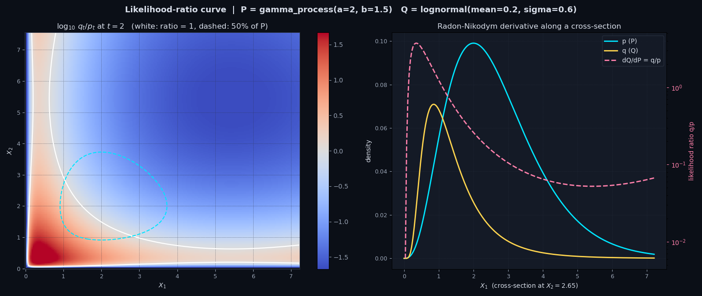
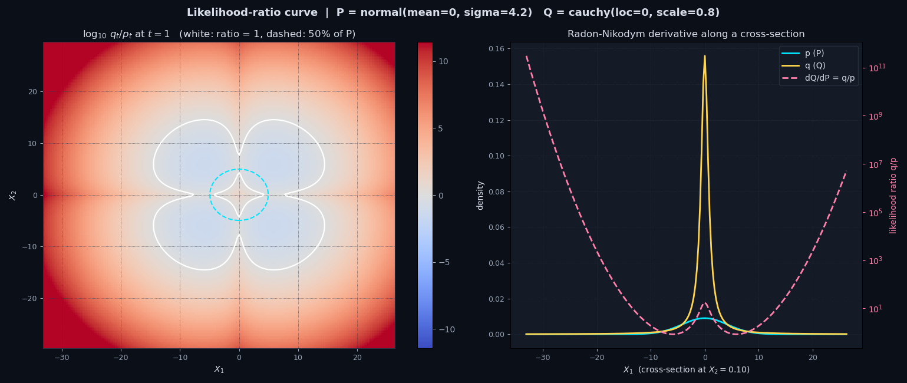
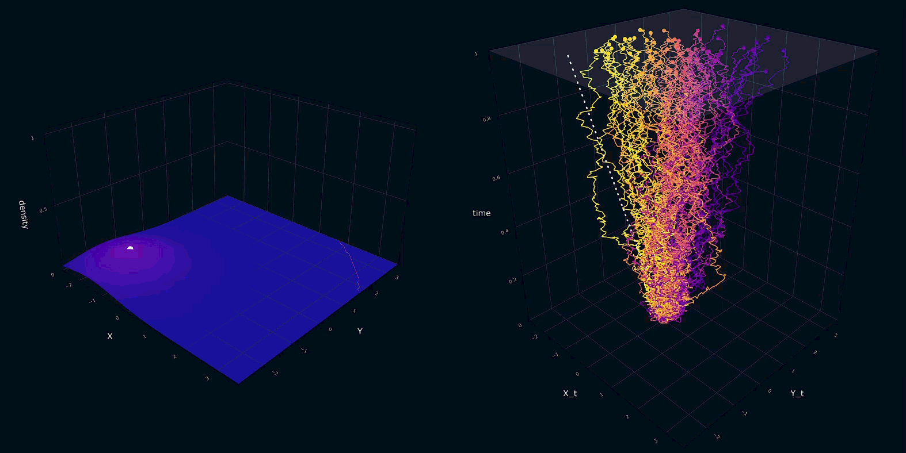
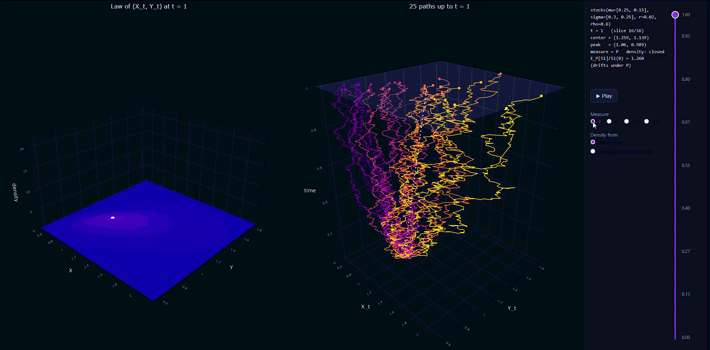

# radonika

> Python library to make interactive simulations to see path-laws of 2-D stochastic processes and other statistical tools to investigate the pdf surface. This gives the geometry behind **Radon-Nikodym change-of-measure** for a process (under different numeraire), in particular Girsanov's Theorem and **Esscher's Tilt** methods that helps in **Financial modelling**. 

📖 **Theory & Dev Log**: Check out GitHub repo [Development of radonika library](https://github.com/kalaapks/radonika_theory-dev) for a complete Jupyter notebook journal covering the prerequisite math, foundational Python simulations needed for Stochastic processes using `stochastic`, and then step-by-step development of `radonika`. The journal covers the following prerequisite [math](https://kalaapks.github.io/radonika_theory-dev/01_2D_Stochastic_processes/Math_prerequisites.html) topics:
1. *Measure theory*: Multivariate Girsanov, Radon-Nikodym process, Esscher tilt, Absolute Continuity vs. Mutual Singularity, Margrabe's Exchange Option Formulae
2. *Statistics*: Effective Sample sizes, Esscher Importance Sampling & Saddlepoint Centering, Kullback-Leibler (KL) Divergence Rate
3. *Numerical*: Monte-Carlo approx for $\mathbb{E}[.]$, Gaussian smoothing of weighted binning 


[](LICENSE)
[](pyproject.toml)
---


<p align="center">
  
  <br>
  <b>Gamma jump process pdf evolution over time and the process itself</b>
</p>

<p align="center">
  
  <br>
  <b>Stock prices under measures ℙ, ℚ, ℚ<sub>1</sub> (stock1 as numeraire), ℚ<sub>2</sub> (stock2 as numeraire) does not change the actual paths and only reweights them</b>
</p>

<p align="center">
  
  <br>
  <b>Esscher Tilt via Monte Carlo Reweighting (pdf showing finite-sampling roughness).</b>
</p>

At the end of this file we have added the codes for these plots.


## The idea in one minute

There are no python libraries that helps us see the probability laws of Stochastic processes in higher dimensions. There are libraries such as `stochastics` & `aleatory` that helps with these in 1-D. This library does the same in 2-D and much more such as *Esscher's tilt* (which proves to be a very strong tool when *Girsanov* can't be applied) and statistical test related to comparison of two measures. 

Consider a process $\{(X_t, Y_t)\}_{t \in [0,1]}$ and finitely many paths of the process are realized. These paths are random and depending on where the paths end up at time $t$, we get an approximate shape of the pdf at time $t$. As we move in temporal axis we get the entire family of pdfs $\{p_t(x,y)\}_t$ indexed by time. This is what we see in above figures. 

Having only the terminal distribution is not good enough. We need the entire evolution to get the true picture of the process. Consider Brownian bridge and i.i.d. $(0, \sigma^2)$ for example.

.gif)

.gif)

Both Brownian bridge and i.i.d. $(0, \sigma^2)$ have the same starting and terminal distributions but only one of them is i.i.d.. To distinguish between them we need to see more and more of these snapshots along the temporal direction. So, it is a good idea to "see" how the density evolves over time. That is what the above diagrams highlight.

---

## Install and Tour

```bash
pip install -e .          # from this folder
```

Visit [`Demo.ipynb`](Demo.ipynb) for full parameter signatures, mathematical explanations, and gallery examples. To our knowledge, there is no Python package that treats **two-dimensional stochastic processes** as first-class objects and lets you look at their *laws* and at *how those laws change under a change of measure*. `radonika` does that.

The library has prepared the following families of 2-dimensional processes:

- `bm` (correlated), `bm_bridge`, `poisson`, `gamma_process`, `cauchy_process`, `stocks` (corrleated), `stocks_neutral`, `normal`, `laplace`, `cauchy`, `student_t`, `exponential`, `uniform`, `lognormal`, `iid`

- Passing a scalar (e.g., mu=0.5) applies the same parameter to both coordinates. Passing a length-2 list/array (e.g., mu=[0.5, -0.2]) gives each coordinate its own parameter.

- Any i.i.d. noise from `scipy.stats` can be used into the library. Other customizations of our choice can be done too such as `coupled_poisson` for example. See [`Demo.ipynb`](Demo.ipynb) on how to make them.

The main functions/methods:

- `analyze` : Static multi-slice scatter, Highest Density Region (HDR) contour evolution figure.
- `plot_law`, `tilt` :  Interactive 3-D Dash, Plotly, Evolving density surfaces alongside sample paths, exponentially tilted process toggle, change of measure toggle.
- `lr` : Singular measure check, Radon-Nikodym process plots.
- `lrc`, `summary`, `ess` : 2D Heatmap comparison of two measure (other stat-tests)
- `exchange_option` : Margrabe, numeraire change: closed form vs Monte Carlo.
- `rare` : Naive Monte-Carlo vs Esscher importance sampling

See [`Demo.ipynb`](Demo.ipynb) for in depth exploration.

Hints: your IDE shows the signature (`normal(` -> `mean, sigma, seed`), `stocks(` -> `mu, sigma, r, seed, rho, verbose`).
In Jupyter, press Shift+Tab inside the brackets.

## Using radonika and pondering
 
```python
import radonika as rd     # everything lives in one namespace
```
### 1. Using `m.analyze`

```python
m = rd.stocks(mu=[0.12, 0.08], sigma=[0.35, 0.35], r=0.02, rho=-0.75, seed=1)
m.analyze(t=4, T=1.0)
```

Contours of the pdf for negatively correlated stock prices; when Stock1 booms, Stock2 crashes and vice-versa.

```python
m_pois = rd.poisson(rate=[3.0, 5.0], seed=1)
m_pois.analyze(t=6, T=2.0)      #I decided to keep t<=6, or else top plot will clutter
```


If you have seen the pdf of a discrete process, such shapes for contours will not be strange to you. In case you haven't, luckily that is exactly what `radonika` is for. See the next plot.

### 2. Using `plot_law`

```python
m = rd.poisson(rate=2.0, seed=1) #discrete
m.plot_law(start=None, time=None, time_slice=35, n=60, seed=1)
```


### 3. Using `lrc`

```python
p = rd.gamma_process(a=[2.0, 2.0], b=[1.5, 1.5], seed=3)
q  = rd.lognormal(mean=[0.2, 0.2], sigma=[0.6, 0.6], seed=3)
z_crescent = rd.lr(p, q)
z_crescent.summary(t=2.0)
z_crescent.lrc(t=2.0)
```

We are more likely to land in **red-region** under `q` and in **blue-region** under `p` and **cyan-dashed line** shows where 50% mass lies. **Cyan-dashed line** in deep red or deep blue region means low Effective Sample Size (few rare paths carry lot of weight during reweighting from `p` to `q`).
```python
z_clover = rd.lr(rd.normal(0, 4.2, seed=1), rd.cauchy(0, 0.8, seed=1))
z_clover.summary(t=1.0)   #low ESS value=2.26 (2/8000 paths were of use)
z_clover.lrc(t=1.0)
```


### 4. Using "closed-form" vs "reweight" in `m.tilt()`

The `closed-form` and `reweight` toggles appear when we code `m.tilt()`, for example, 
```python
m = rd.bm(mu=0.5, sigma=1.0, seed=1)
m.tilt(time_slice=12, n=70, theta_range=(-2, 2), seed=1)
```



For processes such as `bm`, when we change the drift along the vector $(1,1)$, it still is a `bm`. So, we have the luxury to recompute the `pdf` nicely for every single `theta` value. This is the "closed-form" and pdfs looks clean in the first gif. In the second one, we use Monte-Carlo sampling for the pdf and it shows up as roughness of the pdf.

### 5. Using Change of Numeraire for `stocks` (`P`, `Q`, `Q1`, `Q2`)
```python
m = rd.stocks(mu=0.45, sigma=0.4, r=0.03, seed=1) 
m.plot_law(start=None, time=3, n=600, seed=1)
```



## License

MIT
